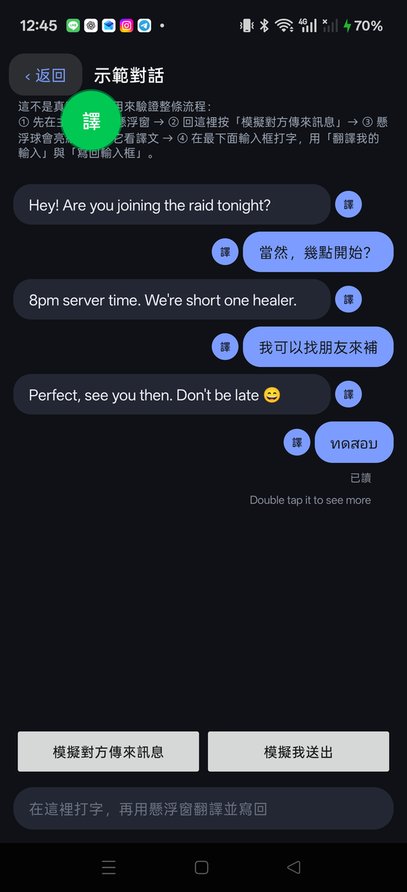
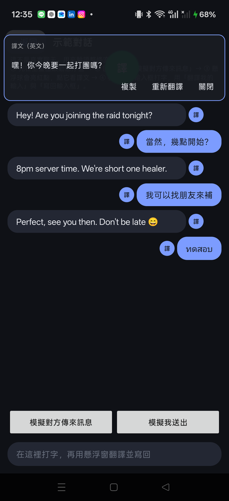

# Overlay Translator 懸浮翻譯

[](https://github.com/verlioe/overlay-translator/actions/workflows/ci.yml)

An Android **live translation overlay** for chat apps. It reads the other person's messages through
an AccessibilityService, translates them with an LLM **together with the conversation context**, and
can write the translation straight back into the chat input box.

Side-load only — this app is **not** on Google Play, and it needs an accessibility service, which is
why it is distributed as source.

<p align="center">
  
  
</p>

---

## Features

| | |
|---|---|
| **Live mode** | Tap the floating ball to start translating whatever chat is on screen. A small dot appears next to every incoming message; tap a dot to open its translation. |
| **Context-aware** | The last N messages of the conversation are sent along with the message being translated (default 8 turns), so pronouns and short replies ("OK", "555") make sense. |
| **Both directions** | Incoming text → your language, and your draft → the other person's language, ready to paste back into the input box. |
| **Tone** | 3 relationship-aware tones — `熟人閒聊` (casual banter, teasing allowed), `普通閒聊` (neutral), `正式禮貌` (polite/formal). The tone is applied to every translation and to the diagnosis. |
| **Diagnosis** | Reviews your draft: politeness, wording, nuance — with a **preview of the suggested rewrite** (foreign sentence + what it means back in your language). Accepting the suggestion writes it into the preview. |
| **Language label** | The translation window title tells you which language the original was in (`譯文（泰文）`), detected on-device without an extra API call. |
| **Chat-noise filtering** | Read receipts ("已讀", "Seen"), accessibility hints ("Double tap it to see more"), date separators and app toolbars are **not** treated as messages. |
| **No per-app rules** | Nothing is hard-coded per chat app. Extraction is heuristic (node tree + geometry), so it degrades gracefully on apps it has never seen. |

Everything is heuristic: **there are no per-app resource-ID tables**. That is the whole point (and
the main source of the limitations listed below).

---

## How it works

```
AccessibilityService ──► ScreenTextExtractor ──► A11yBridge (StateFlow) ──► OverlayService
   (node tree)            (heuristic filter)       (single source of truth)      │
                                                                                 ▼
                                                              InlineChipManager (WindowManager overlay)
                                                                                 │
                                                              Dot chips · translation windows · input window
                                                                                 │
                                                     DeepSeekEngine (OpenAI-compatible) + TranslationEngine
```

Key files:

| Path | Role |
|---|---|
| `a11y/ChatAccessibilityService.kt` | Receives accessibility events, throttles them, extracts and publishes a `ScreenSnapshot`. |
| `a11y/ScreenTextExtractor.kt` | The interesting part: BFS over the node tree, chrome/status/hint filtering, "full-width row" handling, and per-message dot-side decisions. |
| `a11y/A11yBridge.kt` | `StateFlow` bridge between the service and the overlay (no direct coupling). |
| `overlay/OverlayService.kt` | Foreground service that owns the ball, the dots and the windows; runs the translation jobs. |
| `overlay/InlineChipManager.kt` | Everything drawn by `WindowManager`: placement scoring (never cover text if there is a free spot), windows, choice chips. |
| `translate/` | `DeepSeekEngine` (HTTP), `TranslationEngine` (prompts, tones, diagnosis format), `LanguageDetector`. |
| `core/AppSettings.kt` | DataStore-backed settings (API key is stored encrypted). |
| `ui/` | Compose screens: main screen, settings, and `DemoChatActivity` — a fake chat used for testing. |

Placement deserves a note: chips are not positioned with hard-coded offsets. Candidate positions are
generated, each one is scored by how much existing text it would cover, and the best candidate wins —
so the layout survives different devices, font scales and languages.

---

## Requirements

- Android **8.0 (API 26)** or newer. `compileSdk 37`, `targetSdk 35`.
- **Accessibility service** (to read on-screen text) and **Display over other apps** (for the overlay).
  Both must be granted manually in system settings.
- Your own **DeepSeek API key** — or any OpenAI-compatible endpoint (base URL + model are configurable).
  The key is stored on-device, encrypted.
- JDK 17 and the Android SDK to build.

---

## Build

```bash
# 1. Android SDK path (not committed)
echo "sdk.dir=/path/to/Android/Sdk" > local.properties

# 2. Build
./gradlew assembleDebug           # Windows: gradlew.bat assembleDebug
# → app/build/outputs/apk/debug/app-debug.apk
```

Optional Windows helpers used by the author:

- `build-apk.ps1` — syncs the project to a local drive, runs Gradle, copies the APK to `artifacts/`.
- `deploy.ps1 -Device <serial>` — installs to a device and re-enables the accessibility service
  (`adb install -r --user 0`, then re-bind).
- `setup-B-drive.ps1` — optional: maps a `B:` drive so Gradle stops fighting with OneDrive.
  This is a Windows workaround, not a project requirement.

## Install & first run

1. Install the APK (side-load, or `adb install -r app-debug.apk`).
2. Open the app → follow the 4 steps on the main screen: grant **overlay** permission, grant
   **accessibility** permission, then press **啟動懸浮窗**.
3. Open **設定**, paste your API key, choose *my language* / *their language*, gender and tone.
4. Switch to any chat app and **tap the floating ball** to turn live translation on (it turns green).

## Using it

- **Ball** — tap: live mode on/off. Drag: move it (position is remembered).
- **Dots** — one per incoming message, next to the message. Tap: open the translation window.
- **Input window** — appears when the on-screen input box has text: translate your draft, pick a tone,
  run **診斷** (diagnosis) to get a review + suggested rewrite, then **寫回** to write it back into the
  chat input box.
- **Demo chat** (`DemoChatActivity`) — a fake conversation shipped in the app so you can try everything
  without touching real messages.

---

## Privacy

- The API key is stored **on the device** (DataStore, encrypted) and is never uploaded anywhere except
  to the endpoint you configure.
- Message text is sent **only** to that endpoint, together with the recent conversation context needed
  for translation. There is no analytics, no telemetry, no third-party SDK in the translation path.
- `artifacts/` and the development notes are **git-ignored** in this repository, because they contain
  real screenshots and dumps from the author's devices.

## Known limitations

Honest list — this is a working personal tool, not a polished product:

- **Heuristic extraction.** Some apps expose a whole message as a single full-width node with no
  children (Telegram 13.x does this), so the bubble's real position cannot be known. For those, the
  dot is pinned to a screen edge chosen by message direction instead of sitting next to the bubble.
- **Direction detection** for those full-width rows relies on the app's timestamp text
  (`Sent at …` vs `Received at …`). Localised builds of a chat app may need an extra pattern.
- **Stale dots** stay visible until the next re-render (the overlay is event-driven).
- A per-message **debug log** (`y=… w=… edge=… len=…`) is enabled in development builds; remove it
  before shipping anything you care about.
- Only tested on a few devices (realme UI / Android 16, Lenovo tablet / Android 16). OEM ROMs that
  aggressively kill background services may need extra battery-optimisation exemptions.

## Development

```bash
./gradlew test                 # 26 unit tests: extraction rules + language detection
./gradlew assembleDebug        # debug APK
```

### Translation-quality eval

`tools/eval_prompts.py` guards the prompt contract. The prompts it checks are generated by
`PromptSnapshotTest` from the app's **own** `DeepSeekEngine.systemPrompt()`, so they can never drift
away from what users actually run.

```bash
# offline: verifies the prompt contract without any API key (this is what CI runs)
./gradlew :app:testDebugUnitTest --tests com.dsh.overlaytranslator.PromptSnapshotTest
python3 tools/eval_prompts.py --check

# for real: calls the model and checks the output contract (needs your own key)
EVAL_API_KEY=... python3 tools/eval_prompts.py --live --model deepseek-flash --record eval-baseline.json
```

The offline check catches the regressions that actually happened during development: the tone rule
disappearing from "my message" translations, the diagnosis prompt losing one of its three sections,
the target language no longer being mentioned, the conversation context not being included, or the
prompt suddenly doubling in size.
## License

[MIT](LICENSE) © 2026 boyic

---

# 中文說明

一個**懸浮在其他 App 上層的即時翻譯工具**。它透過無障礙服務讀取聊天畫面上對方的訊息，
連同**對話上下文**交給 LLM 翻譯，並能把譯文直接寫回你的聊天輸入框。

側載自用，不上架 Google Play；因為需要無障礙權限，所以以原始碼形式釋出。

## 功能

| | |
|---|---|
| **即時翻譯** | 點懸浮球開啟。畫面上每則對方訊息旁會出現一顆小圓點，點圓點看譯文。 |
| **帶上下文** | 翻譯時會附上最近 N 則對話（預設 8 則），所以「OK」「555」這種短句也翻得對。 |
| **雙向** | 對方訊息 → 你的語言；你的草稿 → 對方語言，可直接寫回輸入框。 |
| **聊天語氣** | 三種關係語氣：`熟人閒聊`（可以打鬧吐槽）、`普通閒聊`、`正式禮貌`。 |
| **診斷** | 檢查你的草稿（禮貌、用詞、語感），附**建議改寫的預覽**（外語句子＋翻回你的語言的意思），採納後直接寫回預覽。 |
| **語言標示** | 譯文視窗標題會寫原文語言（例：`譯文（泰文）`），本機判斷、不花 API。 |
| **雜訊過濾** | 「已讀」「Double tap it to see more」、日期分隔線、工具列都不會被當成訊息。 |
| **不寫死 App 規則** | 沒有針對任何 App 的資源 ID 表；擷取全靠節點結構與幾何，遇到沒看過的 App 也只會退步、不會壞掉。 |

## 運作方式

無障礙服務收到事件 → `ScreenTextExtractor` 用 BFS 走節點樹並過濾雜訊 → 透過 `A11yBridge`
（`StateFlow`）發布快照 → `OverlayService` 負責翻譯工作 → `InlineChipManager` 用 `WindowManager`
畫出圓點與視窗 → `DeepSeekEngine`（OpenAI 相容）＋ `TranslationEngine`（提示詞／語氣／診斷格式）。

放置邏輯值得一提：位置不是寫死位移，而是先產生一批候選位置，逐一評估「會蓋掉多少既有文字」，
選蓋最少的；所以換裝置、換字級、換語言都不會壞。

## 需求

- Android **8.0（API 26）** 以上；`compileSdk 37`、`targetSdk 35`。
- **無障礙服務**（讀取畫面文字）與**顯示在其他 App 上層**（懸浮窗），都要自己在系統設定裡開。
- 你自己的 **DeepSeek API Key**（或任何 OpenAI 相容端點，base URL 與模型都可自由填）。金鑰存在
  裝置上（DataStore，加密）。
- 建置需要 JDK 17 與 Android SDK。

## 建置與安裝

```bash
echo "sdk.dir=/path/to/Android/Sdk" > local.properties
./gradlew assembleDebug                       # Windows: gradlew.bat assembleDebug
adb install -r app/build/outputs/apk/debug/app-debug.apk
```

Windows 上作者自己用的輔助腳本：`build-apk.ps1`（同步到本機磁碟後建置）、
`deploy.ps1 -Device <序號>`（安裝並重新綁定無障礙）、`setup-B-drive.ps1`（把專案放到非 OneDrive
磁碟，避免 Gradle 跟 OneDrive 打架；非必要）。

## 第一次使用

1. 安裝 APK → 開 App，照主畫面的四步驟：給**懸浮窗**權限、給**無障礙**權限、按**啟動懸浮窗**。
2. 進**設定**貼上 API Key，選你的語言／對方語言／性別／語氣。
3. 切到任何聊天 App，**點懸浮球**開啟即時翻譯（球會變綠色）。

## 隱私

- API Key 只存在裝置上（加密）；訊息文字只會送到**你自己設定的端點**，加上翻譯所需的近期上下文。
- 沒有分析、沒有遙測、翻譯路徑上沒有第三方 SDK。
- 這個 repo **排除了** `artifacts/` 與開發筆記（裡面有真實截圖與 dump），請不要把那些檔案提交進來。

## 已知限制

- **擷取是啟發式的**：有些 App（例如 Telegram 13.x）把整則訊息回報成一個「佔滿畫面寬度、沒有子節點」
  的節點，泡泡位置根本不存在於無障礙樹裡 → 這種情況圓點會固定在某一側邊緣，而不是緊貼泡泡。
- 上面那種「整列」訊息的方向判斷依賴 App 的時間文字（`Sent at …` / `Received at …`），
  其他語系的改版可能需要補樣式。
- **殘留圓點**：規則改變後舊圓點會留到下一次重畫（overlay 是事件驅動的）。
- 開發版有一行**逐則診斷 log**（`y=… w=… edge=… len=…`），正式使用前建議移除。
- 只在少數裝置上驗證過（realme UI / Android 16、Lenovo 平板 / Android 16）。會積極砍後台服務的
  ROM 可能需要額外設定電池白名單。

## 授權

[MIT](LICENSE) © 2026 boyic
